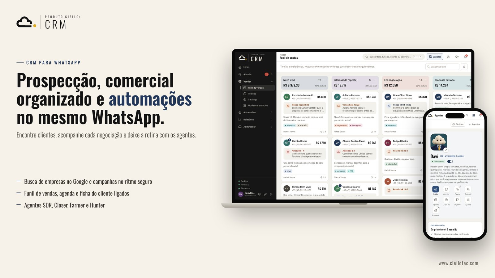
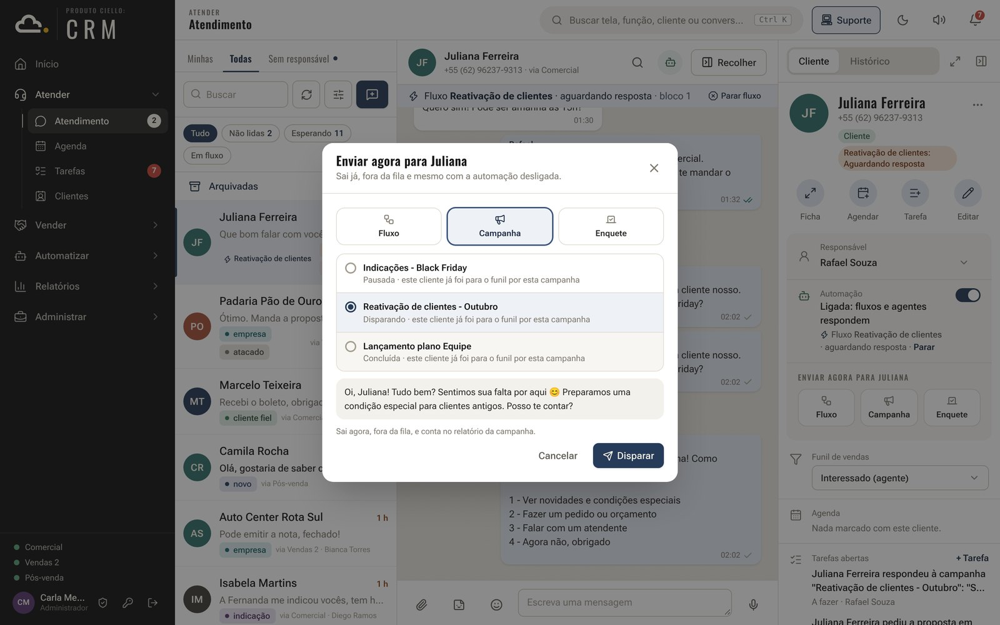
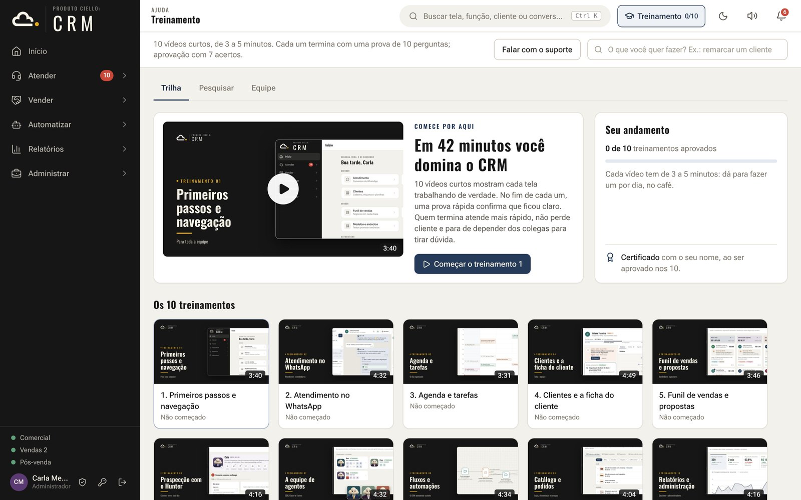
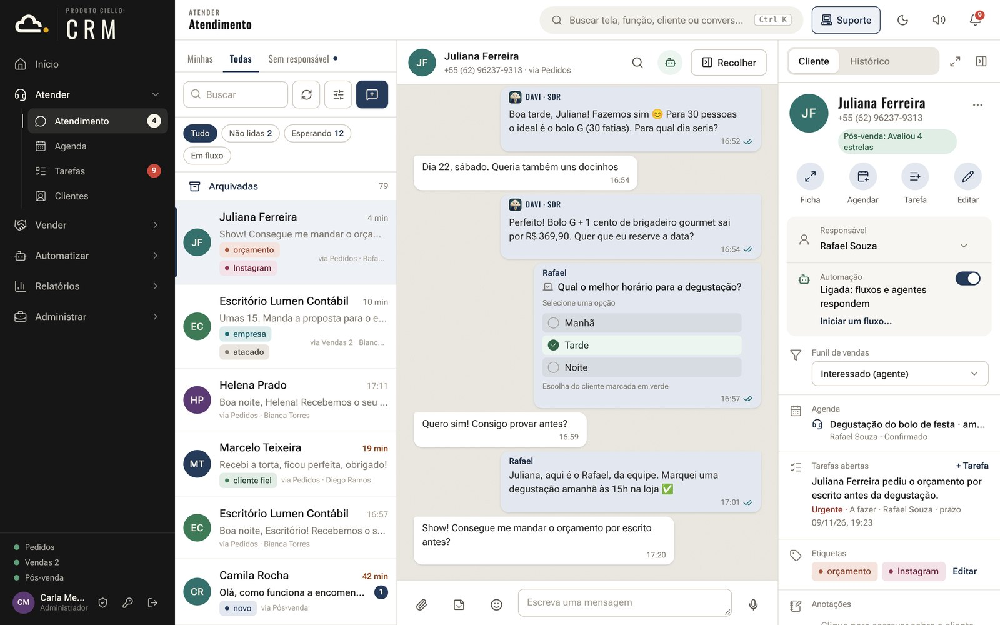
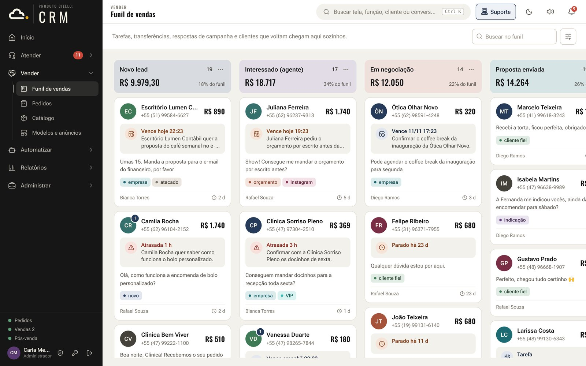
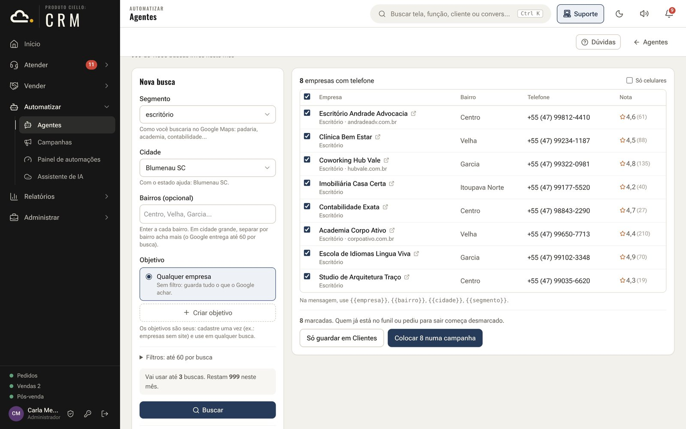
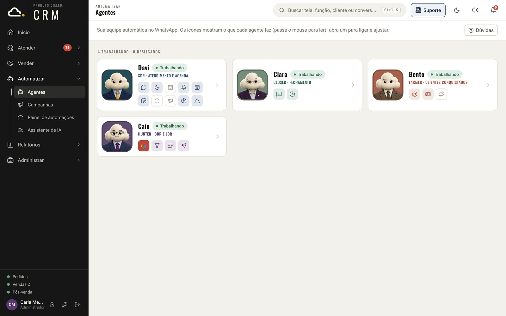
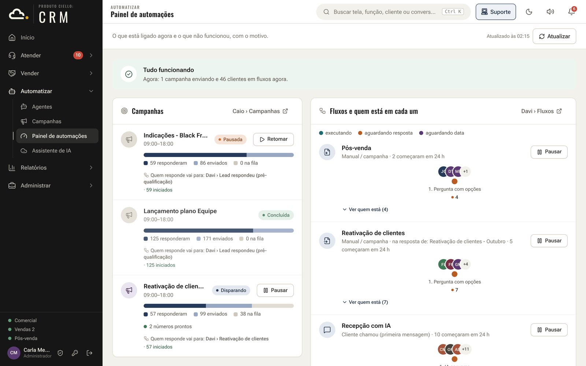
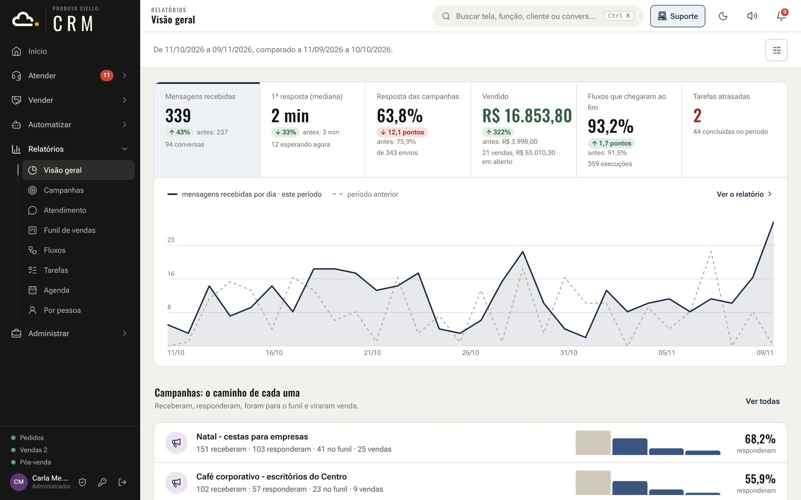

# CIELLO CRM

CRM para WhatsApp: prospecção, atendimento, funil de vendas e agentes que trabalham sozinhos,
instalado no computador da própria empresa.

[**Baixar o instalador para Windows**](https://github.com/MTCiello/CIELLO-CRM-VERSION/releases/latest/download/CIELLO-CRM-Setup.exe)
· [Novidades de cada versão](https://github.com/MTCiello/CIELLO-CRM-VERSION/releases)



## O que é

O CIELLO CRM junta num lugar só o que a equipe comercial faz no WhatsApp: as conversas de todos os
números da empresa, a busca de clientes novos, as campanhas, o funil de vendas, a agenda e quatro
agentes que atendem, retomam e vendem sozinhos, com ou sem inteligência artificial.

Tudo roda no computador da empresa. O banco de dados, as conversas, os arquivos e os backups ficam
na pasta de instalação, sem servidor externo guardando as conversas. A equipe usa pela janela do
programa ou pelo navegador, no computador ou no celular, na rede da empresa ou pela internet quando
o acesso remoto está ligado. Cada pessoa entra com o próprio usuário e vê só as telas e os clientes
que tem permissão para ver.

## Novidades da 0.34.4

- **Treinamento dentro do CRM.** O botão *Treinamento*, no alto de todas as telas, abre 10 vídeos
  curtos (42 minutos ao todo) com as partes marcadas, uma prova de 10 perguntas no fim de cada um e
  certificado ao passar nos 10. A busca acha o trecho do vídeo e a parte do manual que explicam o
  que a pessoa quer fazer. O administrador vê quem já fez cada treinamento.
- **Enviar agora: fluxo, campanha ou enquete.** No painel do cliente, três botões abrem a lista, a
  prévia de como o cliente recebe e um botão para enviar. A campanha sai na hora, pelo número da
  conversa, e o cliente segue nela (nova tentativa, resposta e fluxo de resposta). Quem disse que
  não tem interesse não recebe de novo. Também pelos comandos **/fluxo**, **/campanha** e
  **/enquete**, inclusive nos grupos.
- **Painel de automações mais visual.** Cada campanha mostra numa barra quem respondeu, quem
  recebeu e quem está na fila; cada fluxo mostra os blocos e os rostos de quem está em cada um. No
  celular, o painel se divide em Fluxos, Campanhas e Atividade.
- **Aviso de IA parada.** Quando a IA para de responder (crédito, cota, limite do dia ou chave
  recusada), o administrador recebe uma tarefa urgente com o motivo e o que fazer. Ela se conclui
  sozinha quando a IA volta.
- **Servidor Linux.** Além do Windows, o CRM agora roda numa VPS com Docker e HTTPS automático, e
  os dados do Windows vão para lá pelo backup completo, com a mesma licença.





## Funções

### Atender

- **Atendimento:** todas as conversas de todos os números num chat só, com atalhos *Tudo*,
  *Não lidas*, *Esperando*, *Em fluxo*, *Grupos* e *Disparos*. Respostas, reações, edição,
  encaminhar, áudio (transcrito em texto), figurinhas, arquivos e enquetes do WhatsApp. Comandos
  com "/" para agendar, iniciar fluxo, mandar campanha ou enquete e chamar o Closer.
- **Painel do cliente** ao lado da conversa: responsável, etapa do funil, agenda, tarefas,
  etiquetas, anotações e os botões *Enviar agora*.
- **Agenda:** reuniões e visitas por semana ou lista, com lembretes ao cliente e botão para o
  Google Agenda.
- **Tarefas:** lista e calendário, com prazo, responsável, anexos e aviso no sino. Toda resposta de
  cliente que nenhuma automação tratou vira tarefa para a equipe: nenhuma mensagem fica sem dono.
- **Clientes e Ficha do cliente:** importação de planilhas, conferência de WhatsApp, etiquetas,
  unificação de duplicados e uma ficha única com histórico, negócios, pedidos e dados da empresa.
  O CRM escolhe sozinho o nível de cada cliente (*Carteira*, *Oportunidade* ou *Disparo*) e, quando
  há CNPJ, busca os dados abertos da Receita Federal.



### Vender

- **Funil de vendas:** quadro com etapas personalizáveis, valor de cada negócio, venda ganha ou
  perdida e cartões que chegam sozinhos (respostas de campanha, transferências, clientes que
  voltam).
- **Campanhas:** prospecção com vários números ao mesmo tempo, ritmo e limite por número,
  aquecimento automático de número novo, variações de texto, novas tentativas e um fluxo para quem
  responde. CNPJ baixado ou inapto fica de fora sozinho.
- **Busca de empresas no Google:** o Hunter acha empresas por ramo e cidade, guarda só as que cabem
  no objetivo escolhido e já escreve o gancho da mensagem.
- **Catálogo e pedidos:** itens com variações e combos, página pública de pedidos para o cliente e
  pedidos confirmados pela equipe.
- **Modelos e anúncios:** mensagens salvas e anúncios com chamada para ação.





### Agentes

Quatro agentes, cada um com uma função fixa. O nome e o retrato o cliente escolhe.

- **SDR:** recebe quem chega, qualifica, retoma quem parou, marca a reunião na Agenda e lembra o
  cliente.
- **Closer:** chamado pela equipe na conversa, conduz a negociação até o fechamento com os
  materiais de venda da empresa.
- **Farmer:** cuida de quem já é cliente: pós-venda, recompra e quem sumiu.
- **Hunter:** busca empresas novas, dispara as campanhas e entrega ao SDR quem respondeu.

Cada agente tem um objetivo conferido pelo próprio CRM (reunião marcada, negócio fechado, cliente
de volta), um regulador de força da IA e a lista do que fez em cada conversa. Sem IA, os fluxos
continuam funcionando.



### Automatizar

- **Fluxos:** atendimento automático montado em blocos, sem programar. Começa pela primeira
  mensagem, por palavra-chave, fora do horário, num agendamento ou à mão.
- **Painel de automações:** o que está rodando agora, quem está em cada fluxo e o que não
  funcionou, com o motivo.
- **Assistente de IA:** Anthropic Claude, OpenAI, Google Gemini, Groq, OpenRouter, DeepSeek,
  Ollama ou qualquer API compatível, com personalidades, base de conhecimento, transcrição de
  áudio e detecção de trote.



### Relatórios

*Visão geral*, *Campanhas*, *Atendimento*, *Funil de vendas*, *Fluxos*, *Tarefas*, *Agenda* e
*Por pessoa* (só administrador), com filtro de período, comparação com o período anterior e PDF.



### Administrar

- **Números de WhatsApp:** conexão por QR code, perfil do WhatsApp, limite diário e aviso quando
  um número para de receber.
- **Usuários e permissões:** permissão por tela e acesso por número; o vendedor pode ver só os
  próprios clientes.
- **Perfil da empresa:** o que os agentes e a IA sabem sobre a empresa.
- **Treinamento:** trilha de 10 vídeos com prova, busca no vídeo e no manual, e o andamento da
  equipe para o administrador.
- **Configurações:** acesso pela rede e pela internet, backup diário automático, backup completo
  com botão *Restaurar*, licença e atualizações.

## Requisitos

| Item | Detalhe |
|---|---|
| Sistema | Windows 10 ou 11, 64 bits (ou servidor Linux com Docker) |
| Espaço em disco | Pelo menos 2 GB livres, mais o espaço das conversas e arquivos |
| Pasta | De preferência `C:\CIELLO`: caminho curto, sem acentos e fora do OneDrive |
| Internet | Para o WhatsApp, a IA, a licença e as atualizações |
| Celular | O WhatsApp de cada número que vai ser conectado |

O computador onde o CRM fica instalado precisa estar ligado e com o programa aberto para receber e
enviar mensagens.

## Instalar

1. Baixe o [**CIELLO-CRM-Setup.exe**](https://github.com/MTCiello/CIELLO-CRM-VERSION/releases/latest/download/CIELLO-CRM-Setup.exe).
   O link sempre traz a versão mais nova.
2. Abra o arquivo. Se o Windows mostrar "O Windows protegeu o computador", clique em **Mais
   informações** e depois em **Executar assim mesmo**.
3. Escolha a pasta (padrão `C:\CIELLO`; pode ser outro disco, como `E:\CIELLO`). A pasta precisa
   ser nova ou vazia, só para o CRM, e fora de "Arquivos de Programas".
4. Avance até o fim. O instalador já traz tudo o que o sistema precisa.
5. Abra pelo atalho **CIELLO CRM** e crie o usuário administrador. Esse primeiro acesso só
   funciona no computador onde o CRM foi instalado.
6. Uma instalação nova abre em **Aguardando ativação**. Envie à CIELLO o código da instalação que
   aparece na tela para receber a licença.

Depois disso, o roteiro **Comece por aqui**, no Início, mostra as etapas para deixar o sistema
pronto: conectar o número, preencher o perfil da empresa, ligar os agentes, testar, cadastrar a
equipe e trazer os clientes.

## Atualizar

O CRM confere esta página a cada 12 horas e avisa o administrador quando há uma versão nova. A
atualização é feita com um clique em **Atualizar agora**: o sistema confere a impressão digital e a
assinatura digital do instalador, faz um backup do banco, instala e abre de novo. Um arquivo
diferente do publicado aqui é recusado, e os dados da empresa não são tocados.

Para atualizar à mão, baixe o instalador mais novo e abra. Ele já vem com a pasta atual escolhida,
fecha o CRM, troca os arquivos e mantém os dados.

Cada versão traz, junto com o `.exe`, o arquivo **`.sha256`** com a impressão digital. Para
conferir um download à mão, no PowerShell:

```powershell
Get-FileHash .\CIELLO-CRM-Setup.exe -Algorithm SHA256
```

O resultado precisa ser igual ao conteúdo do `.sha256` da mesma versão.

## Licença de uso

O CIELLO CRM é liberado por uma licença mensal para cada instalação, que se renova sozinha enquanto
a assinatura está em dia. O sistema avisa sete dias antes do vencimento; depois de vencida, há
alguns dias de tolerância e então o sistema passa a funcionar só para consulta até a renovação.
Para trocar de computador, fale com a CIELLO para receber uma licença nova.

## Privacidade

As conversas e os dados dos clientes ficam no computador da empresa. Saem do computador só as
mensagens do WhatsApp, o que vai para o provedor de IA escolhido (quando a IA está ligada), a
consulta de CNPJ em bases públicas, a consulta de versões e de licença, e os chamados de suporte.
A política de privacidade completa está dentro do sistema.

## Suporte

Dentro do sistema, abra **Treinamento › Falar com o suporte**. Problemas e assuntos de licença
vão direto para o chamado; dúvidas de uso mostram antes o trecho do treinamento que responde. O
chamado chega à CIELLO com a versão instalada, e a resposta vai para o contato informado. Site: www.ciellotec.com.

Para relatar um problema de segurança, use o mesmo canal e não abra issue pública.

## Componentes de terceiros

O sistema usa a [Evolution API](https://github.com/EvolutionAPI/evolution-api) para a conexão com
o WhatsApp, licenciada sob Apache 2.0 com condições adicionais da Evolution Foundation. O aviso
completo aparece em *Configurações › Sobre*.

As imagens desta página usam dados fictícios.
