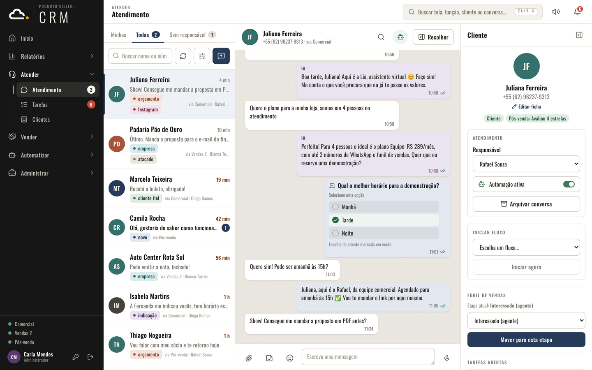
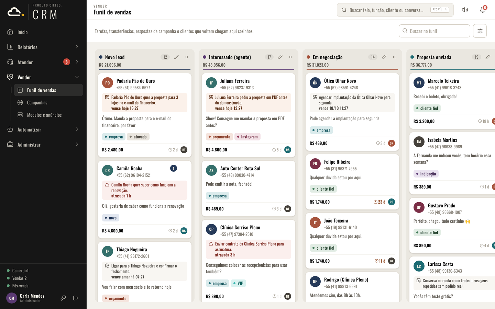
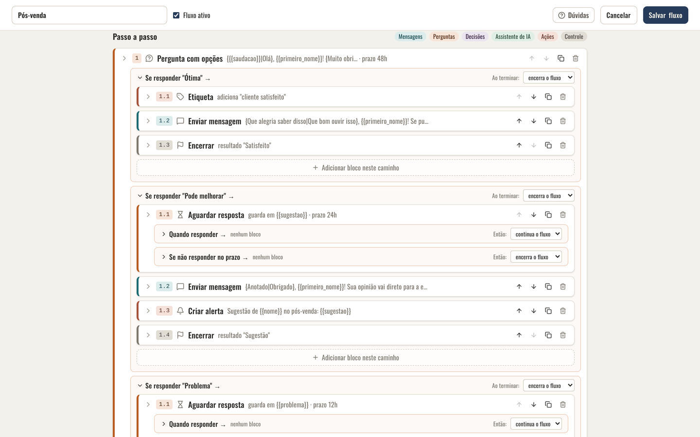
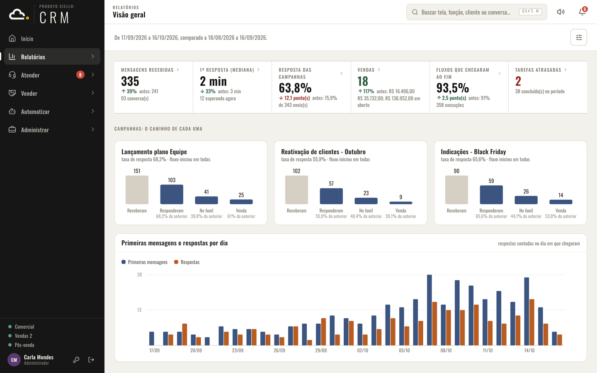

# CIELLO CRM

Atendimento, vendas e automação de WhatsApp para pequenas e médias empresas, instalado no
computador da própria empresa.

Esta página guarda os instaladores do CIELLO CRM para Windows. A versão mais nova está sempre em
[**Releases › Latest**](https://github.com/MTCiello/CIELLO-ERP-versoes/releases/latest).



## O que é

O CIELLO CRM junta num lugar só o que a equipe comercial faz no WhatsApp: as conversas de todos os
números da empresa, o funil de vendas, as campanhas de prospecção e os fluxos que atendem sozinhos,
com ou sem inteligência artificial.

Tudo roda no computador da empresa. O banco de dados, as conversas, os arquivos e os backups ficam
na pasta de instalação, e não há servidor externo guardando as conversas. A equipe usa pela janela
do programa ou pelo navegador, em qualquer computador ou celular da rede da empresa, e também pela
internet quando o acesso remoto está ligado. Cada pessoa entra com o próprio usuário e vê só as
telas que tem permissão para usar.

## Funções

### Atender

- **Atendimento:** todas as conversas de todos os números num chat só, separadas em *Minhas*,
  *Todas* e *Sem responsável*. Mostra o tempo de espera, os tiques de leitura e o "digitando…", e
  tem respostas, reações, edição, encaminhar, áudio, figurinhas, arquivos e enquetes do WhatsApp.
- **Painel do cliente** ao lado da conversa: responsável, etapa do funil, tarefas, etiquetas,
  anotações e o botão para iniciar um fluxo.
- **Tarefas:** quadro *A fazer*, *Em andamento* e *Concluídas*, com prazo, responsável e sino de
  avisos. Os fluxos também criam tarefas para a equipe.
- **Clientes:** base de contatos com importação de planilhas (`.xlsx` e `.csv`), conferência de
  quais números têm WhatsApp, etiquetas coloridas, edição em massa e unificação de duplicados.

### Vender

- **Funil de vendas:** quadro com etapas personalizáveis, valor de cada negócio, venda ganha ou
  perdida e regras que colocam o cliente no funil sozinhas.
- **Campanhas:** prospecção em massa com vários números ao mesmo tempo. O ritmo, as pausas e o
  limite diário valem por número, para proteger os números contra bloqueio. Tem limite de contatos
  novos por dia, novas tentativas, variações de texto para cada mensagem sair diferente e um fluxo
  que atende quem responde.
- **Modelos e anúncios:** mensagens salvas e anúncios com chamada para ação. Quem responde ao
  anúncio vai direto para a equipe.



### Automatizar

- **Fluxos:** atendimento automático montado em blocos, sem programar. O fluxo pode começar com a
  primeira mensagem do cliente, uma palavra-chave, fora do horário de atendimento, num agendamento
  (toda semana, todo dia, a cada N dias) ou à mão. Os blocos enviam mensagens, fazem perguntas com
  opções, mandam enquetes, coletam dados, decidem por condições, movem o cliente no funil e passam
  a conversa para alguém da equipe.
- **Assistente de IA:** funciona com Anthropic Claude, OpenAI, Google Gemini, Groq, OpenRouter,
  DeepSeek, Ollama ou qualquer API compatível. Tem personalidades, base de conhecimento,
  transcrição de áudio, detecção de trote e um interruptor para cada área onde a IA atua. Sem IA,
  os fluxos continuam funcionando.
- **Painel de automações:** o que está rodando agora e o que precisa de atenção.
- **Pacotes:** fluxos e campanhas exportados num arquivo para usar em outra instalação.



### Relatórios

Seis telas: *Visão geral*, *Campanhas*, *Atendimento*, *Funil de vendas*, *Fluxos* e *Tarefas*.
Cada uma tem filtro de período, comparação com o período anterior e exportação em PDF.



### Administrar

- **Números de WhatsApp:** conexão por QR code, limite diário por número e sincronização das
  mensagens.
- **Usuários e permissões:** perfis de administrador e usuário, com permissão por tela.
- **Configurações:** acesso pela rede e pela internet, backup diário automático, descadastro de
  quem pede para não receber mensagens, licença e atualizações.
- **Suporte:** botão no alto de todas as telas para abrir um chamado à CIELLO.

## Requisitos

| Item | Detalhe |
|---|---|
| Sistema | Windows 10 ou 11, 64 bits |
| Espaço em disco | Pelo menos 2 GB livres, mais o espaço das conversas e arquivos |
| Pasta | De preferência `C:\CIELLO`: caminho curto, sem acentos e fora do OneDrive |
| Internet | Para o WhatsApp, a IA, a licença e as atualizações |
| Celular | O WhatsApp de cada número que vai ser conectado |

O computador onde o CIELLO fica instalado precisa estar ligado e com o programa aberto para
receber e enviar mensagens.

## Instalar

1. Em [**Releases › Latest**](https://github.com/MTCiello/CIELLO-ERP-versoes/releases/latest),
   baixe o arquivo **`CIELLO-Setup-X.Y.Z.exe`** (X.Y.Z é o número da versão).
2. Abra o arquivo. Se o Windows mostrar "O Windows protegeu o computador", clique em **Mais
   informações** e depois em **Executar assim mesmo**.
3. Escolha a pasta (padrão `C:\CIELLO`; pode ser outro disco, como `E:\CIELLO`). A pasta precisa
   ser nova ou vazia, só para o CIELLO, e fora de "Arquivos de Programas".
4. Avance até o fim. O instalador já traz tudo o que o sistema precisa; se faltar o Visual C++, ele
   instala (o Windows pede permissão).
5. Abra pelo atalho **CIELLO ERP** e crie o usuário administrador. Esse primeiro acesso só
   funciona no computador onde o CIELLO foi instalado.
6. Uma instalação nova abre em **Aguardando ativação**. Envie à CIELLO o código da instalação que
   aparece na tela para receber a licença.

Depois disso, o roteiro **Comece por aqui**, no Início, mostra as etapas para deixar o sistema
pronto: conectar o número, identificar a empresa, ligar o primeiro fluxo, testar, cadastrar a
equipe e trazer os clientes.

## Atualizar

O CIELLO confere esta página a cada 12 horas e avisa o administrador quando há uma versão nova. A
atualização é feita com um clique em **Atualizar agora**: o sistema confere a impressão digital e a
assinatura digital do instalador, faz um backup do banco, instala e abre de novo. Um arquivo
diferente do publicado aqui é recusado, e os dados da empresa não são tocados.

Para atualizar à mão, baixe o instalador mais novo e abra. Ele já vem com a pasta atual escolhida,
fecha o CIELLO, troca os arquivos e mantém os dados.

Cada versão traz, junto com o `.exe`, o arquivo **`.sha256`** com a impressão digital. Para
conferir um download à mão, no PowerShell:

```powershell
Get-FileHash .\CIELLO-Setup-X.Y.Z.exe -Algorithm SHA256
```

O resultado precisa ser igual ao conteúdo do `.sha256` da mesma versão.

## Novidades

As mudanças de cada versão estão descritas na página da própria versão, em
[Releases](https://github.com/MTCiello/CIELLO-ERP-versoes/releases).

## Licença de uso

O CIELLO CRM é liberado por uma licença mensal para cada instalação, que se renova sozinha enquanto
a assinatura está em dia. O sistema avisa sete dias antes do vencimento; depois de vencida, há
alguns dias de tolerância e, então, o sistema fica bloqueado até a renovação. Para trocar de
computador, fale com a CIELLO para receber uma licença nova.

## Privacidade

As conversas e os dados dos clientes ficam no computador da empresa. Saem do computador só as
mensagens do WhatsApp, o que vai para o provedor de IA escolhido (quando a IA está ligada), a
consulta de versões e de licença, e os chamados de suporte.

## Suporte

Dentro do sistema, use o botão **Suporte**, no alto de todas as telas. O chamado chega por e-mail
à CIELLO, com a versão instalada, e a resposta vai para o contato informado.

Para relatar um problema de segurança, use o mesmo canal e não abra issue pública.

## Componentes de terceiros

O sistema usa a [Evolution API](https://github.com/EvolutionAPI/evolution-api) para a conexão com
o WhatsApp, licenciada sob Apache 2.0 com condições adicionais da Evolution Foundation. O aviso
completo aparece em *Configurações › Sobre*.

As imagens desta página usam dados fictícios.
